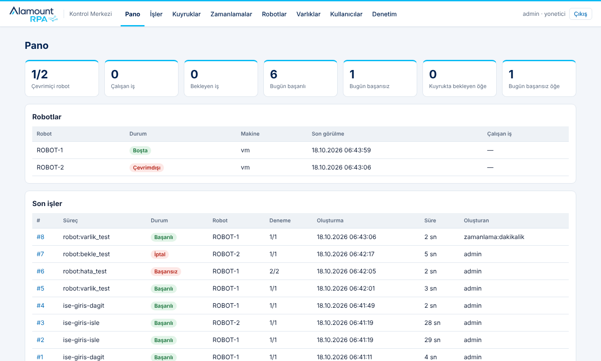
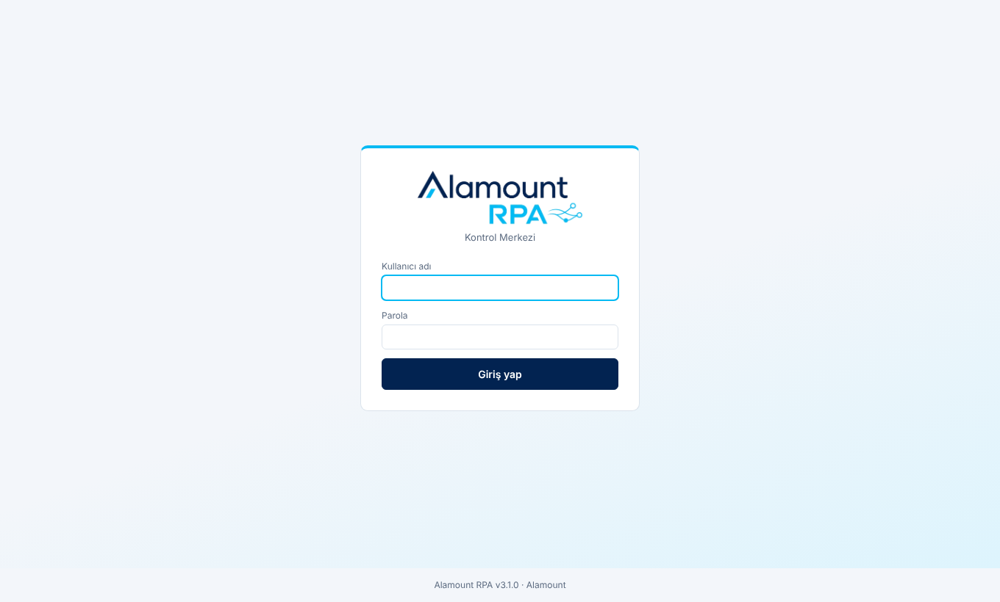
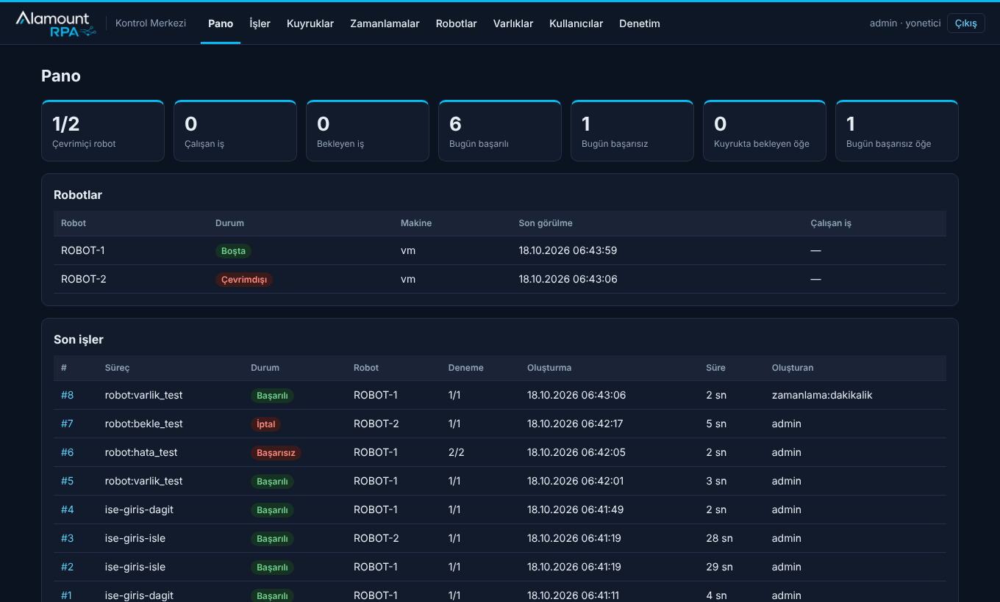
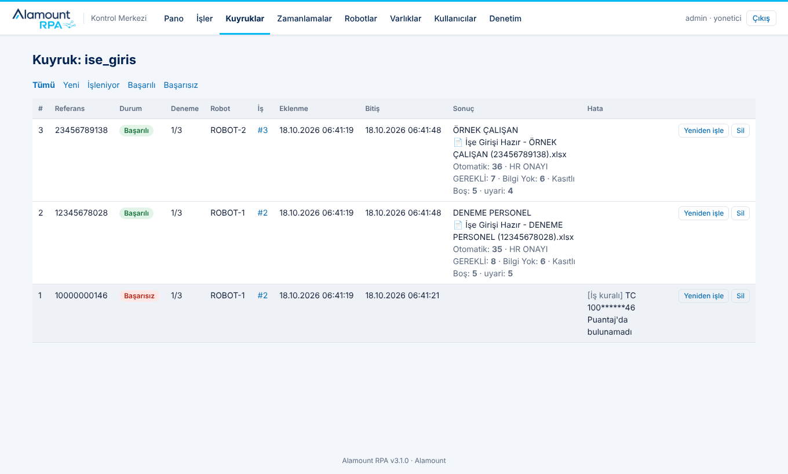
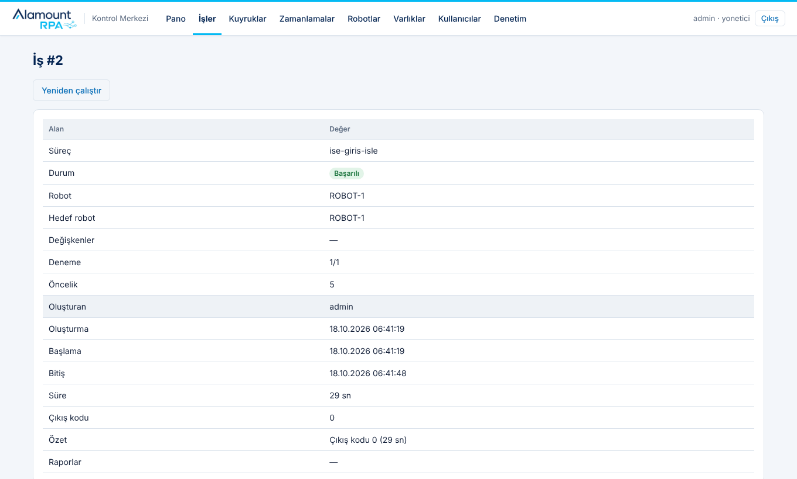
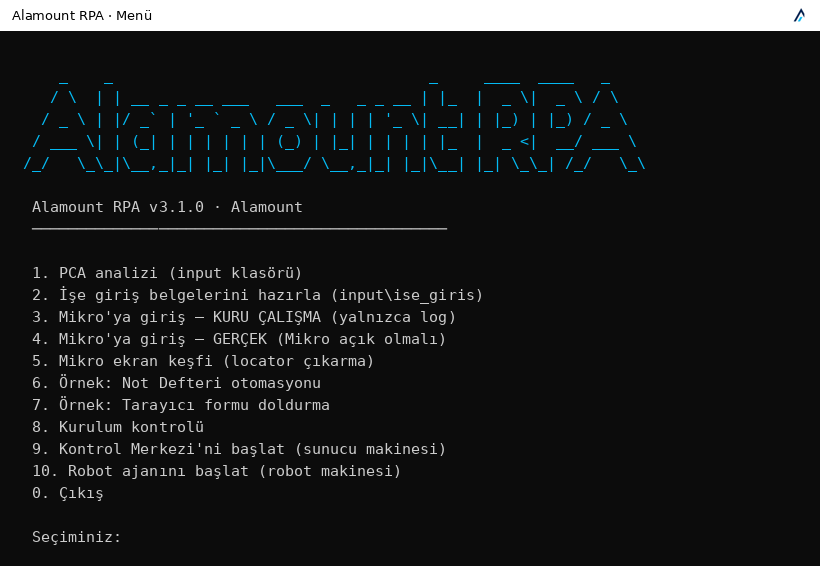
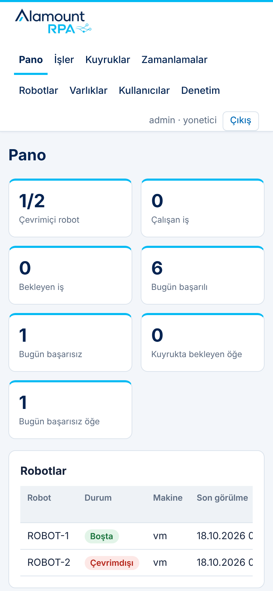

<p align="center"></p>

<p align="center"><b>Windows için kurumsal RPA</b> — Türkçe OCR, işe giriş otomasyonu, Mikro ERP masaüstü otomasyonu,<br>
Robot Framework görevleri ve çok robotlu çalışma için web tabanlı Kontrol Merkezi.</p>

<p align="center"></p>

## Özellikler

| Katman | Teknoloji | Ne yapar |
|---|---|---|
| Orkestrasyon | Robot Framework | Düzenlenebilir `.robot` görevleri, çalışma raporları (`log.html`) |
| Masaüstü & tarayıcı | rpaframework | `RPA.Windows` (UI Automation), `RPA.Browser.Selenium`, `RPA.Excel`, `RPA.PDF` |
| Citrix / RDP | opencv · Tesseract | Görüntü ve Türkçe yazı bularak tıklama/yazma; çok ölçekli eşleme, ekrandan şablon kesme aracı |
| Bağlayıcılar | rpaframework · AlamountBaglayicilar | E-posta, Exchange/Outlook, SAP GUI, SQL Server/PostgreSQL/Oracle/MySQL, REST, Microsoft 365, Salesforce; e-Fatura (UBL-TR), TCMB kurları, MT940 ekstre ve mutabakat, VKN/TCKN/IBAN |
| Gözetimsiz robot | Windows LSA · WTS | Oturumu robot açar (şifreli otomatik oturum açma), RDP kopunca konsola bağlar, kilitlenince yeniden açar |
| Belge → görsel | pymupdf · Pillow · opencv | PDF sayfalarını görsele çevirir, kimlik kartını bulup düzelterek kırpar |
| OCR | Tesseract (Türkçe) | Taranmış belgeleri internetsiz okur; Tesseract pakete gömülüdür |
| Veri & çıktı | openpyxl | Puantaj ↔ TC eşleştirme, checklist kuralları, girişe hazır renk kodlu Excel |
| Kontrol Merkezi | Starlette · SQLite | Rol bazlı web paneli, iş ve öğe kuyrukları, cron zamanlamaları, şifreli varlık kasası, denetim kaydı, e-posta/Teams bildirimleri |
| Ajan katmanı (opsiyonel) | anthropic · MCP | OCR'ın okuyamadığı alanlar için Claude; robotu Claude Desktop'a araç olarak açar (varsayılan kapalı) |

Hiçbir parçası çalışmak için Claude'a, internete ya da ücretli bir lisansa ihtiyaç duymaz.

## Kurulum

1. **[Releases](../../releases/latest)** sayfasından `AlamountRPA_Windows.zip` dosyasını indirip çıkarın (ör. `C:\AlamountRPA`).
2. `AlamountRPA.exe`'ye çift tıklayın → **Kurulum kontrolü**.
3. Tek makine: menüden işe giriş / PCA / Mikro girişini çalıştırın.
   Çok makine: sunucuda `merkez_kur.bat`, robot makinelerinde `ajan_kur.bat` — ayrıntılar [KULLANIM.md](KULLANIM.md) §6.

En güncel paket her zaman: `https://github.com/mtntbl/alamount-rpa/releases/latest/download/AlamountRPA_Windows.zip`

## Ekranlar

| Giriş | Pano (koyu tema) |
|---|---|
|  |  |
| **İş öğesi kuyruğu** | **İş detayı ve canlı log** |
|  |  |
| **Konsol menüsü** | **Telefon** |
|  |  |

Ekran görüntüleri kurgusal test verisiyle alınmıştır.

## Geliştirme

```
python -m venv .venv && .venv\Scripts\activate
pip install -r requirements.txt
python alamount_rpa.py kontrol
python testler/e2e_merkez.py . %TEMP%\alamount_e2e      # 1 merkez + 2 robot uçtan uca test
build_exe.bat                                            # AlamountRPA_Windows.zip üretir
```

Her `main` push'unda GitHub Actions Windows'ta exe'yi derler, Tesseract'ı Türkçe dil paketiyle ekler,
PCA, OCR'lı işe giriş, Mikro kuru çalışma, Not Defteri, tarayıcı ve Kontrol Merkezi + ajan duman testlerini çalıştırır;
hepsi geçerse sürümü yayınlar.

| Klasör / dosya | İçerik |
|---|---|
| `alamount_rpa.py` | Giriş noktası (menü + komut satırı) |
| `gorevler/` | Robot Framework görevleri ve Mikro ekran haritası |
| `merkez_*.py`, `ajan.py` | Kontrol Merkezi ve robot ajanı |
| `belge_ocr.py`, `ise_giris.py` | OCR ve işe giriş kuralları |
| `marka/`, `marka.py` | Logo, ikon, ürün adı, sürüm, renkler |
| `ornek_veri/` | Kurgusal test belgeleri (gerçek kişi verisi değildir) |

## Gizlilik

İşe giriş belgeleri kişisel veri (KVKK) içerir. OCR tamamen yereldir; Claude katmanı varsayılan olarak kapalıdır.
`merkez_veri/` (veritabanı ve kasa anahtarı) ve çalışma klasörleri `.gitignore` ile depodan dışlanmıştır — gerçek belge
ya da Puantaj dosyalarını bu depoya eklemeyin.
